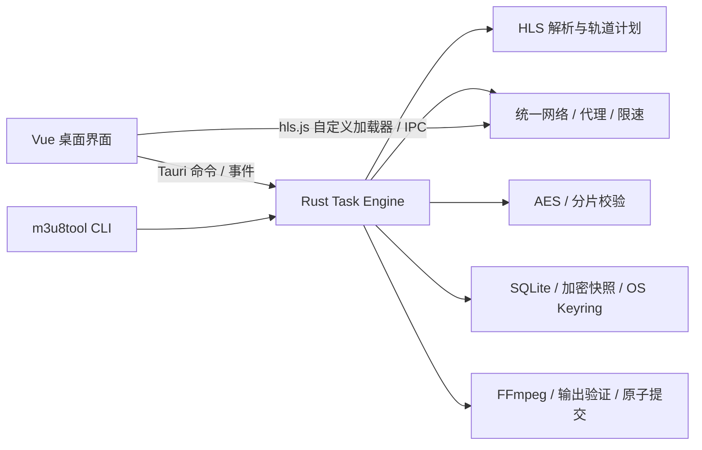

# 架构、构建和数据约定

## 模块与调用



- `crates/core`：解析、网络、密钥、任务生命周期、持久化、预览与媒体提交；不依赖 GUI。
- `src-tauri`：窄 IPC 命令、事件转发、单文件 asset 授权、退出时暂停。
- `src`：Vue 界面和 hls.js loader；媒体 URL 不直接交给浏览器联网，不启动回环 HTTP 服务。
- `crates/cli`：同引擎 JSON/JSONL 接口。外部进程只通过参数数组调用，不经 shell 执行媒体参数。

## 任务与提交

任务以 UUID 标识，启动产生独立 attempt_id 与单调事件序号。重复开始不重复执行；暂停/取消等待所属工作退出。重启把活动状态改为暂停，不自动联网。

分片缓存身份包含资源描述及**该分片实际使用的**密钥/IV 覆盖；缓存读取校验长度与 SHA-256。变更其他密钥上下文不影响该片。缓存目录拒绝符号链接、Windows reparse point/目录联接，写入使用随机临时文件。

分片校验、哈希、文件 flush 和 SQLite 提交在受任务并发数约束的阻塞线程中执行，避免同步磁盘操作阻塞同一个下载流中的全部网络 future。暂停、取消或首个致命错误会取消任务并排空已派发工作，再报告终态，不能把线程池工作遗留到“已暂停”之后。

存储层将相邻 2 ms 内的分片提交合并进一个 SQLite 事务，仍使用 `synchronous=FULL`。调用者只有收到事务提交回执后才把分片计为完成；失败结果返回给同批调用者。并发提交与重新打开数据库的测试验证已确认记录可恢复。

完整缓存的后处理不依赖源站/密钥服务；媒体处理失败仍保留缓存。未记住的凭证不可用于请求剩余资源；仅重新处理原已校验明文缓存时不必重新取得凭证。

输出经过 ffprobe 结构/时长检查及有界采样解码后形成 PreparedOutput。引擎持任务状态锁执行最终提交，与取消排序。默认 `persist_noclobber` 保证不覆盖；显式覆盖备份本次将替换的文件，遇到提交错误回滚。媒体最后提交，旁置文件和报告使用同一名字保留机制。整套输出不是跨文件系统的分布式事务；断电恢复须以媒体验证和任务记录为准。

## 数据

SQLite schema v1：`tasks(id,view,secret)`、`segments(task,track,idx,record)`、`attempts(id,task,view)`，WAL 与事务。`view` 不含完整敏感资源 URL，`secret` 为 AES-256-GCM 密文；系统凭证存储保存包装密钥。未选择记住的 Header、代理口令和密钥从持久化快照移除。

配置为 `settings.json`，schema_version=1；临时文件写入、sync 后原子替换。高于已支持版本的配置/数据库拒绝打开写入。当前首版没有历史 schema 迁移步骤；未来新增迁移必须先备份、测试中断恢复，不得自动清空数据。

## 构建与打包

锁文件：Cargo.lock、package-lock.json。`scripts/stage-runtime.py` 选择并记录实际 FFmpeg 构建；`scripts/dependency-notices.py` 收集实际依赖的声明与许可证副本。运行：

```powershell
npm run tauri -- build --no-bundle
cargo build --release -p m3u8tool
npm run tauri -- bundle --bundles nsis
python scripts/package-portable.py
```

NSIS 产物在 `target/release/bundle/nsis`。资源包括 FFmpeg/ffprobe、构建哈希、许可证和声明。安装器使用 WebView2 offlineInstaller。便携打包脚本只从明确的构建文件创建全新目录，不包含开发数据、测试凭证或缓存。

发布候选验证可拆成暂存、实测、冻结文档和归档：

```powershell
python -X utf8 scripts/verify-installer.py
python scripts/package-portable.py --stage-only
python -X utf8 scripts/verify-portable.py 'release/M3U8-Studio-0.1.0-windows-x64-portable'
# 保存最终报告并提交源码后，使用上一步实际输出的目录：
python scripts/package-portable.py --finalize 'release/M3U8-Studio-0.1.0-windows-x64-portable'
python scripts/verify-archive.py
```

暂存脚本不会覆盖已有目录，重复执行可能增加数字后缀。安装验证会拒绝覆盖已有 M3U8 Studio 安装，并在 finally 中卸载测试安装。正式生成的 `release-manifest.json` 记录源码提交、工作区状态、包体大小和 SHA-256。

## 验证与性能

- `scripts/fixtures.py` 通过 FFmpeg testsrc2/sine 生成自有测试媒体。Node 标准 crypto 模块构造明确的逐媒体序号 IV、显式 IV、轮换密钥及明文回切样例。
- `scripts/acceptance.py` 使用真实 HTTP、认证 HTTP/SOCKS 代理、TLS 自签名服务、CLI、SQLite、AES、FFmpeg/ffprobe；成功输出完整解码，AES 缓存与明文逐字节比较。
- `scripts/native-smoke.mjs` 验证真实桌面 WebView/IPC；浏览器界面测试不能替代此项。
- `cargo run --release -p m3u8-core --example parse_benchmark`：5 次预热、100 次 1,000 分片解析，输出原始测量。
- `scripts/native-performance.mjs`：5 次进程冷启动；3 轮 1,000 片、每片接近 2 MiB、8 并发传输；GUI+核心工作集采样及输入到下一帧反馈。媒体处理故意停止于不可用工具错误，以隔离下载资源测试；它不替代媒体验收。HTTP 基线也完整落盘并 fsync，比较同等级文件提交后的吞吐；FFmpeg 进程独立计数。
- 性能驱动使用 `native-cdp.mjs` 的最小 Runtime.evaluate 调用，结束后释放远端对象；不加载 Playwright 测试脚本。它仍需仅测试时开启的回环调试端口。原有 Playwright 测量结果保留在验收记录中，两种方法不能混称无调试生产测量。任一性能阈值未通过时脚本返回非零。

测试原始结果进入 `test-results`；正式归档结果复制到 `docs/validation`，报告必须说明实测平台与未覆盖项。
